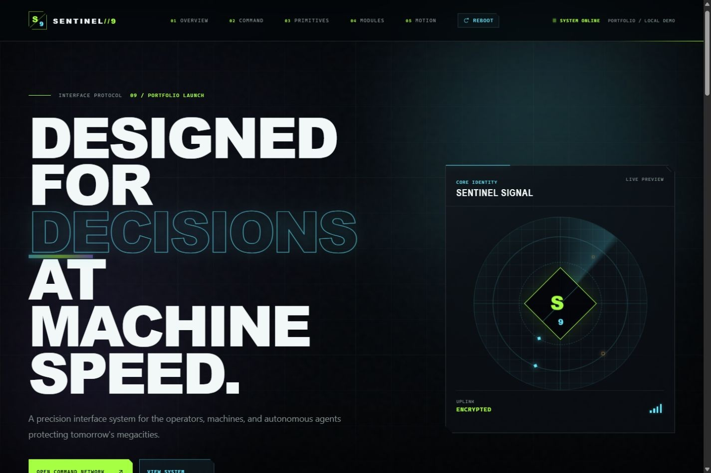
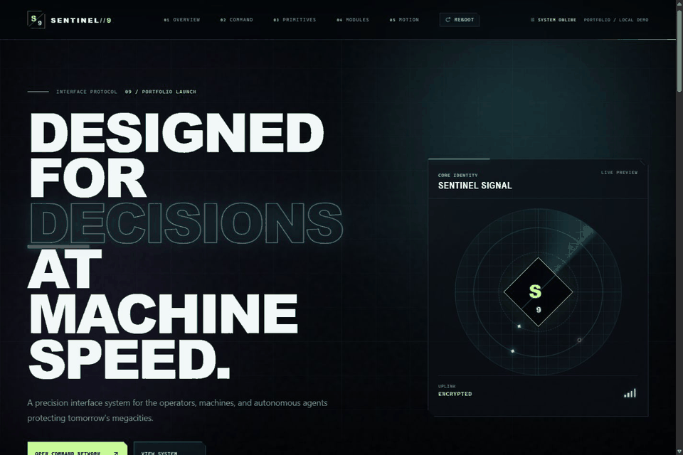
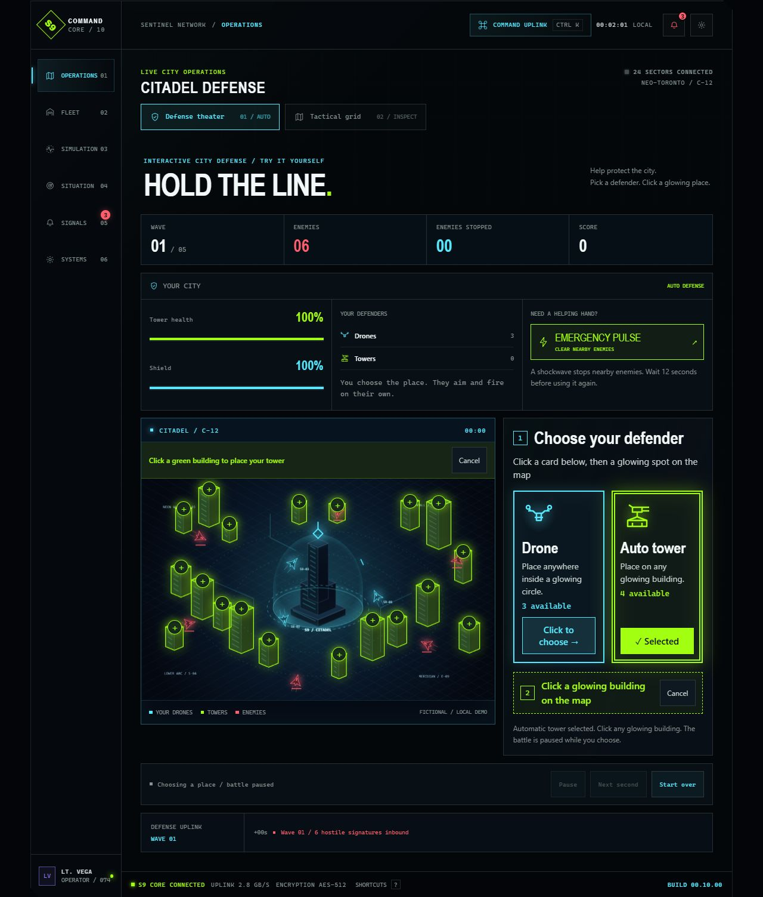
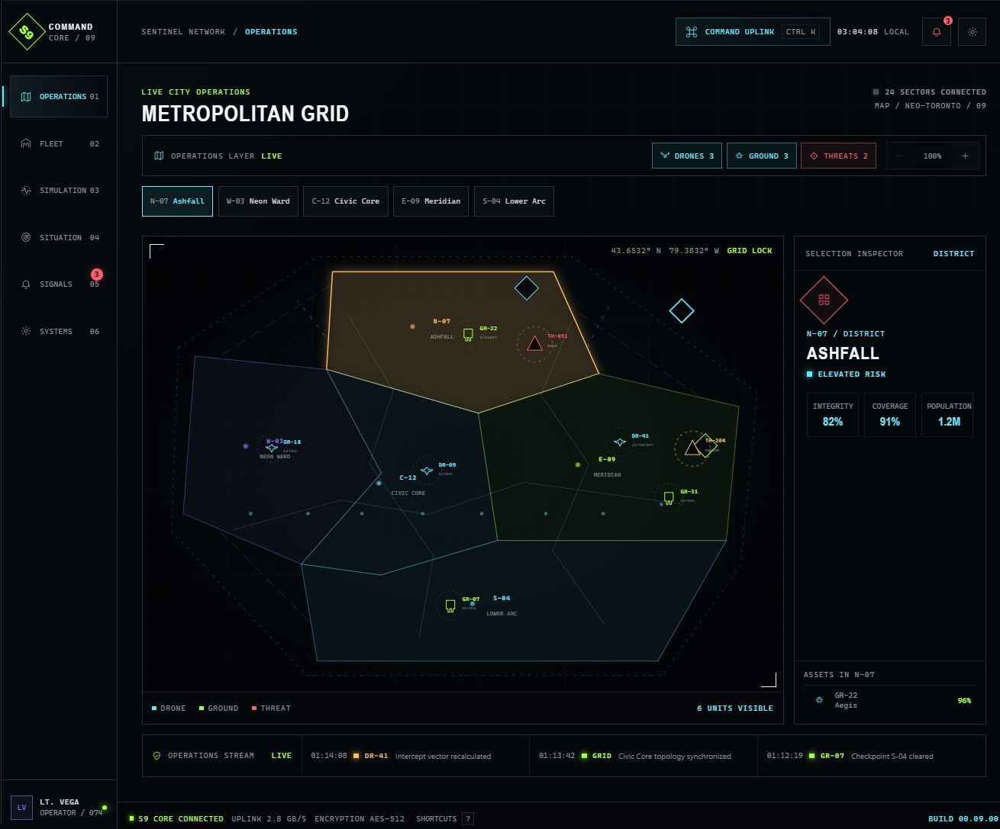
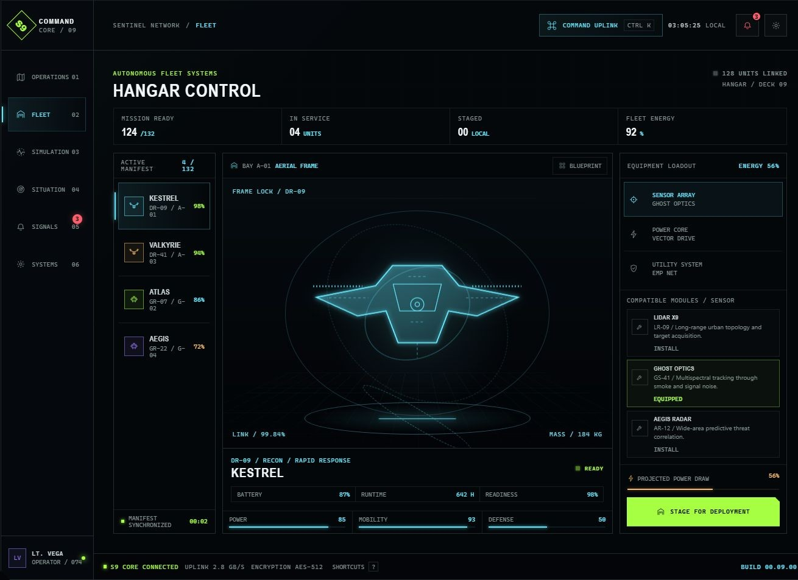
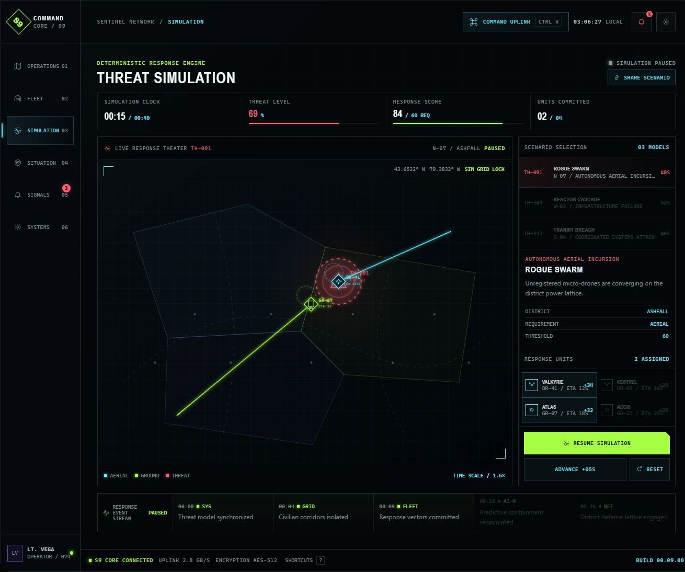
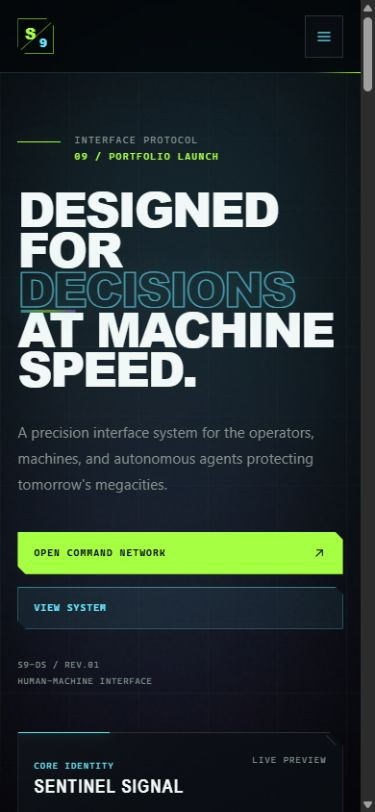

# SENTINEL//9

> Fictional network. Real frontend engineering.

A cinematic cyberpunk command center by **Louis Ho**. Inspect a megacity, configure autonomous drones and ground frames, and run repeatable threat-response simulations—all in a static, browser-local frontend.

[Explore the live demo (EN)](https://louislaziat.github.io/sentinel-9/) · [Version française](https://louislaziat.github.io/sentinel-9/fr/) · [Case study](docs/case-study.md) · [Architecture](docs/architecture.md) · [Launch checklist](docs/portfolio-launch.md)

**React · TypeScript · Vite · CSS/SVG · Vitest · GitHub Pages**

Delivery 10 — Citadel defense / v0.10.0



## Try it in one minute

1. Enter the network or press Escape to skip startup.
2. In **Operations**, check **Your city** above the battlefield, then click the **Drone** or **Auto tower** card beside the map (above it on phones). Click a glowing circle or building to place it. Drones can go anywhere inside an air zone; towers can go on any surrounding building. The battle pauses while choosing a place, and defenders aim and fire automatically. Try the **Emergency pulse**, or switch to **Tactical grid** to inspect districts.
3. In **Fleet**, change a sensor/core/utility module and compare performance and energy draw.
4. In **Simulation**, choose a threat and response team, then launch, pause, or step time forward.
5. Press **Ctrl+K / ⌘K** to search commands, or share a scenario link for the same challenge.



The GIF is an edited sequence of real Delivery 09 app captures, not a real-time performance recording. The original map is now under Tactical grid. Delivery 10's default Operations view is shown below.



## What the project demonstrates

| Area | Implementation |
| --- | --- |
| Visual system | Cinematic startup, blue Decisions signal, atmospheric grid, reusable HUD panels, SVG machines |
| Application state | Six workspaces, preserved fleet/simulation sessions, actionable signals, shared preferences |
| Pure interaction rules | Fixed-step tower defense, repeatable response scoring, derived loadout telemetry, search ranking, validated URL/storage recovery |
| Keyboard and motion | Command palette, native dialogs, equipment arrow keys, inert mobile menu, OS reduced motion, global calm mode |
| Loading and hosting | Lazy command/fleet modules, isolated clock, hidden-tab suspension, static GitHub Pages deployment |
| Languages | English by default, full French interface at `/fr`, state-preserving EN/FR switch |
| Quality | 110 regression tests, strict type checking, lint, documentation/media/build-asset validation |

### Six workspaces

- **Operations:** automatic five-wave Citadel defense; two visible cards to place three reserve drones in four air zones and four towers across 19 surrounding buildings; shields, an emergency pulse, simple playback controls, and the original tactical district map.
- **Fleet:** four representative frames, blueprint mode, configurable equipment, energy calculations, and service-aware staging.
- **Simulation:** three incident models, response assignments, routes, pause/step/reset, and containment outcomes.
- **Situation:** system-wide topology, coverage, and fictional telemetry.
- **Signals:** severity-coded event queue and acknowledgement counts.
- **Systems:** page-wide motion, precision coordinates, and tactical contrast controls.

<details>
<summary>Screenshot gallery</summary>

### Operations



### Fleet



### Simulation



### Phone layout



</details>

## Run locally

Use **Node.js 24 or newer**. Node 24 is used in both GitHub workflows.

```bash
npm ci
npm run dev
```

Open the local URL printed by Vite. On Windows, stop a running dev server before reinstalling dependencies if a native module is locked. A regular source edit does not require another install.

English is the default. Append `/fr` to that local URL for French, or use **EN / FR** in the header. The entire interface, all six workspaces, defender help, dialogs, accessible labels, and command search support French. Language switching preserves the current battle, fleet, and simulation; scenario links retain the chosen language. See [localization](docs/localization.md) for the static Pages routes and translation maintenance.

```bash
npm run check:release
```

| Command | Purpose |
| --- | --- |
| `npm run dev` | Local Vite development server |
| `npm run build` | Strict TypeScript check and production build |
| `npm run lint` | ESLint, with zero warnings allowed |
| `npm test` | Run the regression suite once |
| `npm run test:watch` | Interactive Vitest watch mode |
| `npm run preview` | Serve the built production app locally |
| `npm run check` | Lint, tests, type checking, and build |
| `npm run check:release` | All checks plus docs, media, metadata, and built-asset validation |

## Controls and persistence

Ctrl+K (Windows/Linux), ⌘K (macOS), or slash opens the 32-command palette after startup. Use arrows and Enter to execute, Escape to dismiss, **?** for help, and **Alt+1–6** for workspaces. Editable fields suppress single-key and workspace shortcuts.

Scenario links carry only an incident and response team. The recipient starts at briefing. An active response survives workspace navigation and recovers paused on refresh. Fleet equipment/staging survives workspace changes but resets on refresh. Preferences are shared between both panels and saved locally when storage is available.

Citadel defense starts automatically when its arena becomes visible in Operations. It suspends offscreen, during dialogs, and in hidden browser tabs; reduced motion offers manual stepping. Switching between Defense theater and Tactical grid preserves the drill, while leaving Operations starts a fresh drill on return. This local game is separate from the scenario-based Simulation workspace.

Environmental Motion affects the whole page, including startup and the Decisions signal; OS reduced-motion settings take priority. Hidden tabs suspend simulation and ambient work without hidden-time catch-up.

## Architecture and documentation

- [Architecture and state lifetimes](docs/architecture.md)
- [Portfolio case study and interview walkthrough](docs/case-study.md)
- [Design system](docs/design-system.md) and [command shell](docs/command-center.md)
- [Operations](docs/operations-grid.md), [Citadel defense](docs/citadel-defense.md), [fleet](docs/fleet-systems.md), and [simulation engine](docs/threat-simulation.md)
- [Commands, shortcuts, and sharing](docs/command-system.md)
- [English/French routes and localization](docs/localization.md)
- [Accessibility/performance verification](docs/production-polish.md)
- [Media guide](docs/media-guide.md), [launch handoff](docs/portfolio-launch.md), and [draft release notes](docs/release-notes.md)
- [Changelog](CHANGELOG.md)

## Deployment

Pushes to `main` run CI and the GitHub Pages workflow. Both run release checks; Pages uploads `dist` only after its checks succeed. Vite uses `/sentinel-9/` automatically inside GitHub Actions, and the validator checks that asset prefix. The app needs no backend or route-rewrite service.

Publication remains an owner action: review, commit, push, wait for CI/Pages, and inspect the deployed build. A GitHub tag/release is optional. Follow the [launch checklist](docs/portfolio-launch.md) rather than treating local verification as proof of deployment.

## Scope, privacy, and attribution

This is a **fictional frontend demo**, not a real defense system. Units, coordinates, operators, events, network metrics, and encryption labels are fixtures. There is no backend, real fleet control, authentication, analytics integration, or real-time data feed. Equipment changes do not alter simulation scoring.

Preferences and saved runs use optional local storage; the normal application flow does not upload them. Sharing a URL discloses its scenario/team configuration. Deployed source maps expose source code, so secrets and personal contact details must never be committed or included in build variables.

Created by Louis Ho with AI-assisted implementation and iterative review. The case study describes that process without claiming client work, production adoption, or unmeasured business results. Targeted accessibility checks are documented; complete WCAG certification is not claimed.

## Delivery roadmap

0. System foundation — repository, quality tooling, GitHub Pages
1. Brand and design system — tokens, components, navigation, motion
2. Cinematic entry — city reveal and boot sequence
3. Command center shell — workspaces, alerts, preferences
4. Operations grid — city map, districts, unit telemetry
5. Fleet systems — inspection, hangar, equipment configuration
6. Threat simulation — incidents, assignments, deterministic engine
7. Command system — palette, shortcuts, scenario sharing
8. Production polish — accessibility, responsive refinement, performance
9. Portfolio launch — media, documentation, architecture, release preparation
10. Citadel defense — animated Operations arena, attack waves, visual defender cards, glowing drone/building placement zones, shields, and emergency pulse

Deliveries 00–09 form the original project scope. Delivery 10 extends Operations with a futuristic tower-defense experience.

## License

[MIT](LICENSE). Original interface graphics are code-native CSS/SVG; committed media is captured from this application.

`SENTINEL NETWORK // BUILD 00.10.00`
