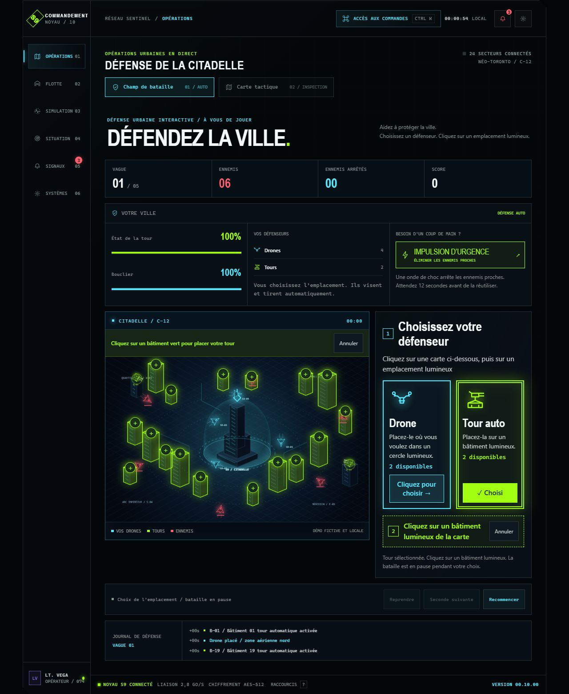

# English and French interface

English is the main/default version. French is explicitly selected by `/fr` or `/fr/`, including the GitHub Pages repository prefix:

- English: `https://louislaziat.github.io/sentinel-9/`
- French: `https://louislaziat.github.io/sentinel-9/fr`

The header's EN/FR links preserve the current query and section hash. Ordinary clicks update the route and locale without reloading the app; modifier clicks still open the corresponding URL normally. Browser back/forward also updates the language. No browser-language detection or stored-language preference overrides the English root.

## Coverage

The landing sections, startup, navigation, six command-center workspaces, defender choices/targets, canvas city labels, equipment, simulation events, command palette, preferences, sharing dialogs, footer, and accessible descriptions have French copy. French command searches work alongside original English keywords. Scenario links generated in French retain `/fr` and the same validated incident/team format.

Proper names, callsigns, machine IDs, coordinates, technical standards and key names remain stable. Repository documentation is English; the French footer marks the case-study link **Étude de cas (EN)**. The shared social image also retains its original English artwork, with French alt text and metadata on the French entry.

## Implementation

- `src/lib/i18n.ts`: explicit route helpers, normalized catalog lookup, dynamic placeholders, and French numeric formatting.
- `src/locales/fr.json`: English source phrases mapped to French. Preserve `{0}`, `{1}`, etc. slots when editing dynamic messages.
- `LocaleProvider`: in-memory language state, history navigation, HTML language, titles, descriptions and canonical metadata.
- `Localize`: React-rendered presentation translation at component boundaries. It canonicalizes child keys identically in both languages, preserving refs, handlers, controlled values, IDs and behavioral props. Game/session state is never translated.
- `LanguageSwitcher`: real EN/FR links with current-page and language annotations.
- `vite.config.ts`: a build-only plugin emits `dist/fr/index.html` with localized metadata and noscript copy. Both entries reference the same assets under the configured base path. No server, rewrite service, SPA fallback or router package is required.

Adding new visible source copy requires a matching catalog entry, including any whole dynamic phrase assembled from JSX text and values. `node scripts/audit-translations.mjs` prints advisory missing candidates; it also includes intentional class names, codes, and keyboard names, so review the output manually. Unknown phrases fall back to their original source text rather than blank UI. The audit is not proof of complete translation coverage.

## Verification

Fifteen tests cover explicit routes, Pages prefixes, query/hash retention, default English output, all six labels, dynamic copy, numeric formatting, catalog placeholders, accessible labels, and untouched behavioral props. `npm run check:release` validates both physical HTML entries, languages, French metadata, English default alternate, and built assets. Browser checks cover the six French workspaces, French command execution and scenario links, keyboard placement, state-preserving language switching, and phone/tablet layouts.

The generated entries support direct links and refresh on static hosting. Local production verification is not confirmation that the owner has pushed or deployed the update.
